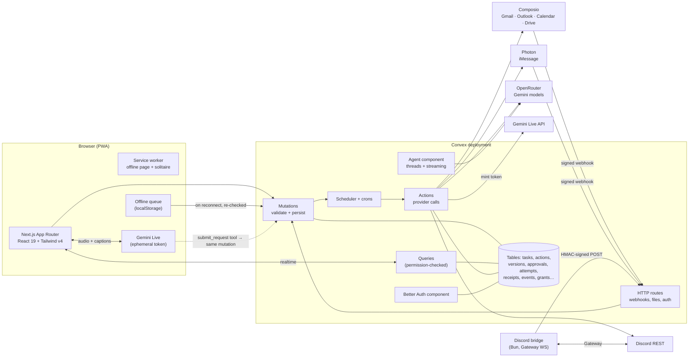
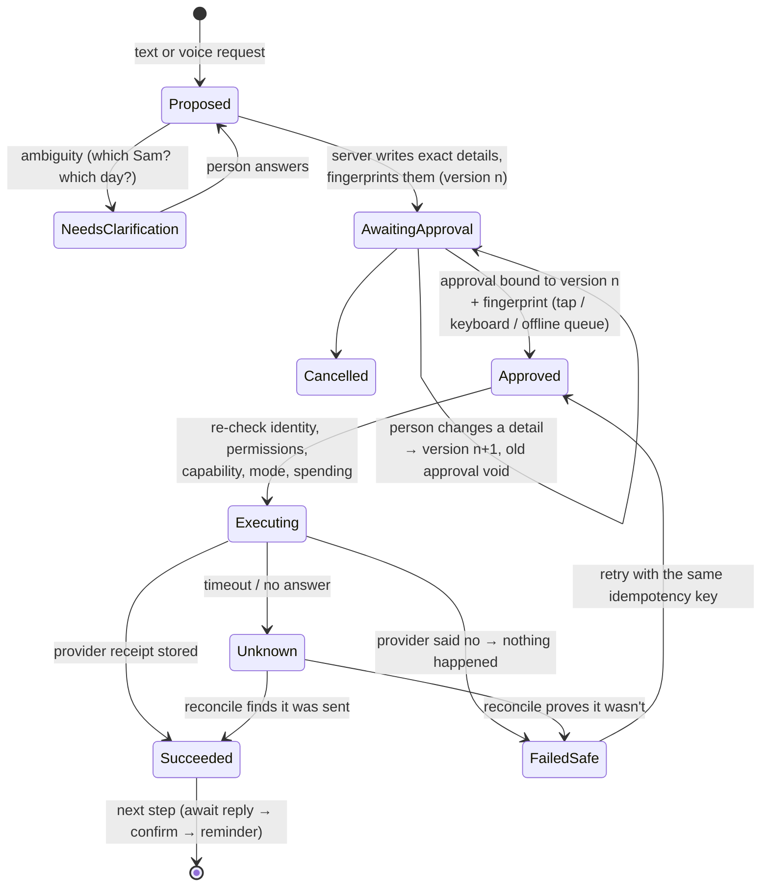
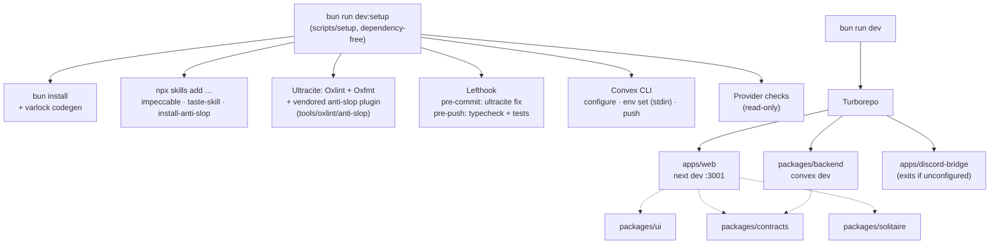

# LifeLink

LifeLink is a calm, accessible assistant that helps older adults stay close to family, keep track of the day, and check messages that look wrong. You speak or type what you need, review exactly what will happen, approve it, and then follow its progress until it's done.

Two commands get you from a fresh checkout to a running app:

```bash
bun run dev:setup   # once, and again whenever you like: it keeps what's already set
bun run dev         # web app on http://localhost:3001, Convex, and (if configured) the Discord bridge
```

---

## Contents

- [Getting started](#getting-started)
- [Environment](#environment)
- [Product](#product)
- [Design](#design)
- [Architecture](#architecture)
- [Integrations](#integrations)
- [Development](#development)
- [Project status](#project-status)

---

## Getting started

### What you need

- **Bun** 1.4 or newer: [bun.sh](https://bun.sh).
- **Node** 22.18.0 or newer. Ultracite and the Convex and skills CLIs run on it.
- **A free Convex account.** Setup opens the browser to sign in.
- **Provider keys (optional).** Each one turns on more of the app. Without them, LifeLink runs fully in **Practice mode**, where every outcome is simulated and clearly labelled.

### `bun run dev:setup`

`dev:setup` works on a fresh clone, before any dependencies are installed. It is dependency-free Bun code in `scripts/setup/`.

| # | Step | What it does | Required? |
| --- | --- | --- | --- |
| 1 | Tools | Checks Bun and Node versions | Required |
| 2 | Dependencies | Runs `bun install` (the postinstall also generates the typed web env) | Required |
| 3 | Agent skills | Installs and verifies `impeccable`, `design-taste-frontend` (taste-skill), and `install-anti-slop` project-locally for the active agent (detected, or `--agent=<name>`) | Required |
| 4 | Lint config | Verifies the vendored anti-slop Oxlint plugin (license and provenance), then loads Ultracite + Oxlint + Oxfmt with `ultracite doctor` and a real lint pass | Required |
| 5 | Git hooks | `lefthook install`: format on commit, typecheck and tests on push. Skipped until the folder is a git repository | Optional |
| 6 | Convex | Signs in and picks or creates a project (browser). Steers local or anonymous deployments to a free cloud dev deployment so webhooks can reach it | Required |
| 7 | Auth and URLs | Generates `BETTER_AUTH_SECRET` and `BRIDGE_SHARED_SECRET` once, sets `SITE_URL` and `DEMO_MODE_ALLOWED`, and writes `apps/web/.env.local` | Required |
| 8 | Integrations | For each provider: shows where to get credentials, asks with masked input, validates with a harmless read-only call, and provisions what it can (Composio auth configs and webhook, Photon webhook destination, Discord bridge settings) | Optional |
| 9 | Functions | Pushes Convex functions and regenerates `convex/_generated`, then checks that the deployment answers | Required |

It finishes with a status report in two groups: **Required** (✓, ✗, or !) and **Optional** (✓, or – for skipped, with what still works without it). Then it prints the start command. It exits non-zero only if a required step failed.

#### Running it again

Running setup again is safe:

- Existing values are kept, and generated secrets are never regenerated.
- Provider resources are reused, never duplicated.
- Integrations you skipped are offered again next time.

Progress, without any secrets, is recorded in `.lifelink/setup-state.json`.

| Flag | Effect |
| --- | --- |
| `--yes` | No questions. Keeps existing values and skips integrations that aren't set up. Also used automatically when there's no terminal (CI) |
| `--reconfigure` | Asks again about integrations that are already set up, so you can change a key |
| `--only=<id>` | One integration: `openrouter`, `gemini_live`, `composio`, `photon`, or `discord` |
| `--agent=<name>` | Install the skills for a specific agent, for example `codex` |
| `--skip-install` | Don't run `bun install` |

#### Steps that need a browser or dashboard

- **Convex sign-in** opens automatically. Choose a new project called `lifelink`; development deployments are free.
- **Each provider console:** setup prints the URL and exact steps before asking for a key.
- **Discord:** setup prints a bot install link for a private server you share with family.
- **People's own accounts** (Gmail, Outlook, and so on) are connected by each person in the app, under **Connections**.

### `bun run dev`

Turborepo runs three things:

- `next dev` on port 3001;
- `convex dev`, which watches and pushes functions;
- the Discord bridge, which exits immediately with a one-line note when Discord isn't configured.

Nothing slow happens at start-up: no installs, checks, or network calls beyond the dev servers themselves.

Sign up at `http://localhost:3001`. During onboarding, choose **It's for me** and tick **Practice mode** to get sample family, email, and an appointment. Then try **"Can Sam drive me to my appointment on Tuesday?"**

---

## Environment

Secrets never touch the browser or a committed file. There are three places:

| Where | What | Written by | Example |
| --- | --- | --- | --- |
| **Convex deployment env** | All server secrets and provider settings | `dev:setup`, via `convex env set NAME`, with the value on stdin so it never appears in arguments or shell history | [`packages/backend/.env.convex.example`](packages/backend/.env.convex.example) |
| `apps/web/.env.local` | Public URLs only (`NEXT_PUBLIC_CONVEX_URL`, `NEXT_PUBLIC_CONVEX_SITE_URL`, `NEXT_PUBLIC_SITE_URL`) | `dev:setup` | [`apps/web/.env.example`](apps/web/.env.example) |
| `apps/discord-bridge/.env.local` | Bot token, bridge secret, Convex site URL | `dev:setup`, only when Discord is configured | [`apps/discord-bridge/.env.example`](apps/discord-bridge/.env.example) |

`packages/backend/.env.local` is written by the Convex CLI itself (`CONVEX_DEPLOYMENT`, `CONVEX_URL`). All `.env*.local` files are git-ignored.

**Validation happens at four layers:**

- **Web build:** `apps/web/.env.schema` (Varlock) types and validates the public variables at build time; `src/env.ts` is generated from it.
- **Setup:** each provider key is checked with a read-only call. The calls are listed under [Integrations](#integrations).
- **Backend runtime:** functions read settings through `convex/lib/env.ts`. A missing setting turns the feature off honestly instead of failing later.
- **In the app:** the Connections screen and `status.integrations` show what is configured.

---

## Product

**Who it's for.** An older adult who wants to stay in touch and independent, without learning six apps. Family members can be invited to _see_ specific things. They can never act on the person's behalf.

**The one flow everything follows.** _Speak or type → review the exact action → approve → follow progress → see an accurate result._

| Screen | What it's for |
| --- | --- |
| **Today** | Greeting and briefing (read aloud on request), appointments, due reminders, what's waiting for approval, and recent family messages |
| **Ask** | Separate saved conversations, streamed replies, inline reviews of the latest proposal, and a History drawer |
| **Task** | A journey gauge (asked → sent → replied → confirmed → reminded), the exact message slip, approve, change, or cancel, earlier versions, and outcome handling |
| **Messages** | Family threads over iMessage, email, Discord, or in-app, with photos, drafts that become tasks, and delivery status in words. **Help me understand** explains a received message (what it asks, dates, what's missing, labelled guesses) and offers up to three replies that only fill your message box. **Recap this conversation** separates what was agreed from what was only offered, shows what LifeLink's records show as done, and proposes next steps for review |
| **Email** | Automatic local concern screening, optional AI analysis of emails you choose, **Help me understand**, and reply drafts that are never sent automatically |
| **Scam check** | Paste text, pick an email, take a photo of a letter, or choose a screenshot. Check a speakerphone call with live captions and spoken warnings, or try the fixed practice call without a microphone. Results explain the warning signs and offer **Ask someone you trust** through a draft for review. Photo quotes remain unverified. See [Scam check v2](docs/scam-check-v2.md) for privacy and verification limits |
| **Trusted circle** | People and how to reach them, including **Set up iMessage** for each contact; plus sharing: one-time invitation codes with chosen scopes and an optional end date, scope changes, and immediate revoke |
| **Family** (family member's view) | Only what was shared, re-checked on every read. Photos come through a permission-checked file route; there is an in-app reply |
| **Groceries** | Saved lists, preferences, estimated costs, list budgets, and copy or print for shopping yourself |
| **Solitaire** | Klondike with keyboard play, tap-to-move, undo, hints, and local save and resume. Works offline |
| **Connections** | Each person's own accounts, with a plain capability list: works, not wired yet, or not offered |
| **Settings** | Text size, contrast, light or dark, less movement, read-aloud, speaking speed, captions, profile, Practice mode, and **How I like help**: short or detailed, one step at a time, a help language, and private notes |

**Principles.**

- Nothing consequential happens without approval of that exact version.
- The app never claims a capability a provider doesn't have.
- Simulated outcomes are always labelled **Practice**.
- Errors say what happened, that nothing was lost, and what to do next.

---

## Design

The **Drafting Room** direction follows the Victorian inventor and brass-machinery theme, informed by the user's SBU Hacks references: parchment, copper, dark ink, and functional brass details. The shared design contract is [apps/web/DESIGN.md](apps/web/DESIGN.md); the route inventory and Paper links are in [docs/ui-route-audit.md](docs/ui-route-audit.md).

**Palette.** Writing paper `#FFFDF8`, parchment `#FAF4E8`, ink `#2D2118`, secondary ink `#6C5C4C`, copper `#8F3F25`, and restrained brass `#AC741C`. The Reach mark (two clasped hooks, ink for the person and orange `#CB6527` for LifeLink) replaces the earlier pin-link mark and interlocking monogram.

**Type.** IBM Plex Sans throughout: 18px body, 24px section titles, and 32px page titles. User text-size, contrast, color-theme, and reduced-motion preferences remain available.

**Interaction.** Navigation stays consistent across routes, including Solitaire. Chat reviews display the latest action version directly in the conversation; chat history opens in a right-side drawer. Instrument markings and ticket edges carry the workshop character without covering content.

**Accessibility commitments.**

- Targets are at least 48px, with a 3px focus ring.
- Every flow works by keyboard, and the approval records whether it was a keypress or a tap.
- Live captions show during voice, read-aloud is available everywhere text matters, and speaking speed is adjustable.
- Reduced motion is supported, headings follow a proper hierarchy and receive focus on navigation, and every input has a label.
- Errors appear inside the block that failed, with a way to recover.

**Components.**

- shadcn/ui (Base UI flavour) lives in `packages/ui`, restyled to these tokens.
- Unused primitives were removed, so the package holds only what the app renders.

---

## Architecture

### Runtime



### Task flow: Gemini proposes, Convex decides



**Guarantees the backend enforces, with tests in `packages/backend/tests`:**

- **Model output is a proposal, never an instruction.** Message wording, recipients, and amounts are re-derived and validated server-side. Incoming messages and model output cannot authorize spending or change permissions.
- **Approvals are tied to one version.** An approval binds to `{actionId, version, fingerprint}`. Any consequential edit creates a new version and voids the approval.
- **Unknown outcomes are reconciled before any retry.** Each attempt carries `${actionId}:v${version}` as its idempotency key (Spectrum SDK `clientMessageId`, Discord `nonce` + `enforce_nonce`). An attempt that never answers becomes `unknown`, and a cron marks stalled attempts. Partial successes are kept.
- **Webhooks are authenticated and deduplicated.** Composio uses Standard-Webhooks HMAC, Spectrum uses its documented `X-Spectrum-*` HMAC signatures, and the bridge uses HMAC with a 5-minute window. A `by_dedupe_key` index records each event once.
- **Family access is checked on every read.** Queries and file delivery re-check the viewer's live grant scope on each call, and revoking takes effect immediately.
- **Message steps are kept distinct.** _Sent_, _replied_, _confirmed_, and _reminder_ are separate steps; a reply is interpreted, then proposed as a confirmation you approve.

### Tooling



### Offline and PWA

- **Install:** the web app manifest provides icons (including maskable) and shortcuts to Today, Ask, and Solitaire.
- **What is cached:** only `/offline.html`, `/solitaire`, content-hashed `/_next/static/*`, and icons. Signed-in pages, RSC payloads, Convex traffic, and files are never cached.
- **Offline work:** approvals and requests made offline wait in a local queue. On reconnect each is sent with `method: "offline_queue"` and goes through the full server checks again, so a stale approval of an old version is refused, not executed.

---

## Integrations

### What each person can connect

Generated from `packages/contracts/src/integrations.ts`, the same catalog the Connections screen renders.

| Service | Via | Account needed | Capabilities |
| --- | --- | --- | --- |
| **Gmail** | Composio | A Google account. | ✅ Read emails you pick for a summary<br>✅ Write a draft for you to review<br>✅ Send an email after you approve it<br>✅ Notice new mail (checked about once a minute)<br>✅ Find appointments in emails |
| **Outlook** | Composio | A Microsoft account. Some work accounts need an administrator's consent. | ✅ Read emails you pick for a summary<br>✅ Write a draft for you to review<br>✅ Send an email after you approve it<br>✅ Notice new mail as it arrives<br>✅ Add an approved appointment to your Outlook calendar |
| **Google Calendar** | Composio | A Google account. | ◻️ See your upcoming events (not wired yet)<br>✅ Add an approved appointment |
| **Google Drive** | Composio | A Google account. | ✅ Find files you already keep in Drive<br>✅ Save appointment notes as a document after you approve it |
| **PayPal** | Composio | The developer's PayPal app credentials. Personal sign-in is not offered. | ◻️ Look up invoices (not wired yet)<br>✖️ Send money to a person: PayPal's connector has no send-money action, and this app will not move money |
| **Facebook** | Composio | A Facebook Page you manage. | ◻️ Post to a Page after approval; read and answer Page messages (not wired yet)<br>✖️ Personal timeline and friends' messages: not allowed by Facebook's API |
| **Instagram** | Composio | An Instagram Business or Creator account. | ◻️ Share a photo post after approval; answer DMs within 24 hours (not wired yet)<br>✖️ Personal accounts: not supported by the API |
| **eBay** | Composio | The developer's eBay app credentials. | ◻️ Search listings (not wired yet)<br>✖️ Your listings, orders, or purchases: the connector only covers public search |
| **iMessage** | Photon Spectrum Stable | Link an existing dashboard registration in **Trusted circle**. Each person texts their assigned number first; no Photon account or dashboard teammate invitation is needed. | ✅ Send a text or photo after you approve it<br>✅ Receive replies<br>◻️ Delivery/read updates (not wired; receipts confirm provider acceptance)<br>✖️ Start a conversation before that contact texts their assigned shared-line number |
| **Discord** | Discord bot | The family member shares a server with the bot, or has messaged it first. | ✅ Send a direct message after you approve it<br>✅ Receive replies (needs the bridge running with `bun run dev`) |

✅ implemented in LifeLink · ◻️ the provider supports it but no screen uses it yet · ✖️ the provider doesn't offer it. Live-provider verification is listed under [Project status](#project-status).

### What the developer configures once (`dev:setup`)

| Integration | Settings (Convex env) | Setup's validation call (read-only) | Without it |
| --- | --- | --- | --- |
| OpenRouter | `OPENROUTER_API_KEY`, `OPENROUTER_MODEL` (`google/gemini-4-argon`), `OPENROUTER_FAST_MODEL` (`z-ai/glm-5.3-flash`), `OPENROUTER_TTS_MODEL` (`elevenlabs/eleven-v4-turbo`), `OPENROUTER_TTS_VOICE` (`sarah`) | `GET /api/v1/key`, plus each model's `/endpoints` | Built-in rules planner (fine for Practice mode) |
| Gemini Live | `GEMINI_API_KEY`, `GEMINI_LIVE_MODEL` (default `gemini-3.8-live`) | `GET v1beta/models/{model}` | Browser dictation where available; typing always works |
| Composio | `COMPOSIO_API_KEY`, plus `COMPOSIO_AUTH_CONFIGS` and `COMPOSIO_WEBHOOK_SECRET` (provisioned) | `GET /api/v3.1/auth_configs?limit=1` | Sample email in Practice mode only |
| Photon Spectrum Stable | `SPECTRUM_PROJECT_SECRET`, `SPECTRUM_PROJECT_ID`, plus `SPECTRUM_WEBHOOK_SECRET` (provisioned) | Basic-auth `GET https://spectrum.photon.codes/projects/{projectId}` | No iMessage |
| Discord | `DISCORD_BOT_TOKEN`, `DISCORD_APPLICATION_ID`, `DISCORD_PUBLIC_KEY` | `GET /api/v10/users/@me` | No Discord |

**Provisioning notes**

- **Photon Spectrum Stable:** use the UUID project ID and project secret from your existing dashboard. Beta `pho_prj_...` / `pho_sk_...` credentials belong to a different API. Setup uses Basic authentication, keeps existing shared-line users, and configures the Stable webhook. See the [Spectrum API](https://photon.codes/docs/api-reference/introduction).
- **Read-aloud:** ElevenLabs speech is served by OpenRouter's audio endpoint with the same OpenRouter key. No separate ElevenLabs key or browser speech fallback is used. Requests have authenticated per-account limits, bounded text chunks, timeouts, and response-size limits.
- **Composio:**
  - Setup reuses or creates a Composio-managed auth config for Gmail, Outlook, Google Calendar, Google Drive, Facebook, and Instagram.
  - It points the project webhook at `<deployment>.convex.site/webhooks/composio`. It rotates the signing secret only if it doesn't already hold one, because rotating breaks other listeners.
  - PayPal and eBay need your own app credentials in the Composio dashboard.
- **Webhooks need a cloud deployment.** A local deployment can't receive them, so setup skips webhook registration there and says so.

**Grocery shopping:** Instacart is removed from this release. Lists, estimated costs, budgets, copy, and print remain available. LifeLink does not open shopping pages, look up stores, or run recurring shopping handoffs, even if an old Instacart key is configured. Setup no longer asks for that key. Existing task history remains readable; the unused adapter is retained internally. See [retirement details](docs/instacart-retirement.md). Instacart's [developer application page](https://company.instacart.com/business/developers) currently says new applications are closed.

### Set up iMessage for a contact

1. Keep the people already registered in your Photon Spectrum shared-line dashboard. Register any new person there first.
2. Add the exact registered iMessage phone number or email in **Trusted circle** and choose **Set up iMessage**. LifeLink links the existing user and shows the assigned number; it does not create another registration or send an invitation.
3. Ask that person to text the assigned number from the exact registered phone number or email. A phone number and an Apple-account email are different sender identities.
4. Choose **Check for first message** if the contact is still waiting. Once ready, review and approve messages in LifeLink before anything is sent.

Shared-line contacts do not need a Photon dashboard teammate invitation. Setup validates project credentials without contacting those people. See [Spectrum shared-line routing](https://photon.codes/docs/spectrum-ts/providers/imessage/connection-and-routing).

**Practice mode never contacts Spectrum or registers real people.** Its simulated outcomes are labelled **Practice**.

---

## Development

Built at SBUHacks 2026 (October 23 to 25) with Claude Code and Codex.

| Command | What it does |
| --- | --- |
| `bun run dev` | Everything (web, Convex, bridge) |
| `bun run dev:web` / `bun run dev:server` | One side only |
| `bun run check-types` | TypeScript in every package, plus `scripts/` |
| `bun run test` | Vitest in every package (backend uses `convex-test`), plus the setup script's tests |
| `bun run check` / `bun run fix` | Ultracite (Oxlint + Oxfmt + anti-slop) |
| `bun run build` | Production build |

**CI:** [`.github/workflows/ci.yml`](.github/workflows/ci.yml) runs `check`, `check-types`, `test` and `build` on every push to `main` and every pull request. It uses placeholder public Convex URLs, so it needs no secrets. Nothing deploys yet.

**Layout**

```
apps/
  web/               Next.js 16 App Router PWA (src/app, src/components, src/features/solitaire)
  discord-bridge/    Bun Gateway client → signed POST to Convex /bridge/discord
packages/
  backend/           Convex: schema, functions, lib/ (permissions, lifecycle, journey…), integrations/, tests/
  contracts/         Shared, dependency-light types: actions, fingerprints, sharing scopes, integration catalog, model-output schemas
  solitaire/         Pure Klondike engine (deal, rules, undo, serialization) with tests
  ui/                shadcn/ui (Base UI) components restyled to the LifeLink tokens
  config/            Shared tsconfig
scripts/setup/       bun run dev:setup
tools/oxlint/anti-slop/  Vendored anti-slop plugin (MIT, provenance in UPSTREAM.md)
```

**Focused tests:**

- **Backend:**
  - `permissions` covers family scopes, revocation, and file delivery.
  - `approvals` covers version changes voiding approval, and spending and recurring bounds.
  - `events` covers duplicate webhooks.
  - `outcomes` covers unknown → reconcile → retry, and partial success.
  - `journey` covers the ride flow end to end.
  - `scam` covers fabricated and paraphrased quotes, negated warnings, screenshot evidence, the verdict floor, and rescanning stored email.
  - `explanations` and `recaps` cover word-for-word evidence, offers versus agreements, Practice and cloud consent, privacy from family, and preparing steps for review.
  - `replies` covers refusals and maybes in the Practice reply reader.
- **Solitaire:** rules, undo, and serialization.
- **Contracts:** fingerprints, quote evidence and stance, explanation and recap checks, draft safety, and the boundary that keeps private notes out of reply drafts.
- **Discord bridge:** signing and DM filtering.
- **Setup:** masked input, env merging, deployment detection, and mocked Photon project validation (read-only request, rejected credentials, and network failure).

---

## Project status

**Verified locally, against a local Convex deployment in Practice mode:**

- Sign-up, onboarding, and Practice data.
- The full ride journey by keyboard only, from typed request to completed task: request → exact message → keyboard approval → simulated send → Practice reply → interpreted reply → confirmation → reminder.
- Setup runs end to end in non-interactive mode, and again as a rerun.

**Verified with live OpenRouter during the redesign:** the Settings read-aloud sample generated and played to completion using the configured ElevenLabs model; the assistant planned a seeded ride request and presented its inline review in Practice mode. No real message was sent. This does not verify microphone input or Gemini Live.

**Implemented, but not exercised end to end against live providers here:**

- Gemini Live calls.
- Composio OAuth, triggers, and webhook registration.
- Spectrum Stable shared-user discovery, first-text conversation setup, approved sends, and webhooks.
- Discord Gateway and DMs.

Setup uses documented read-only validation calls; passing those checks does not establish end-to-end delivery. Treat the first live run of each integration as the real test.

Spectrum webhook signatures follow the documented Stable HMAC contract. End-to-end webhook delivery and real iMessage sends still require live verification with the user's rotated credentials.
